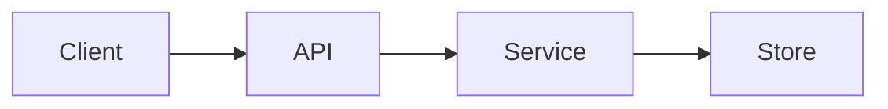

# Architecture

## Components

- EXAMPLE: `api/` — HTTP layer, validates input, calls services.
- EXAMPLE: `store/` — persistence; only module allowed to touch the database.

## Data flow

- EXAMPLE: request → api handler → service → store → response.

## Diagram

## Key trade-offs

- What you gave up to get what you wanted, and why it was worth it.
